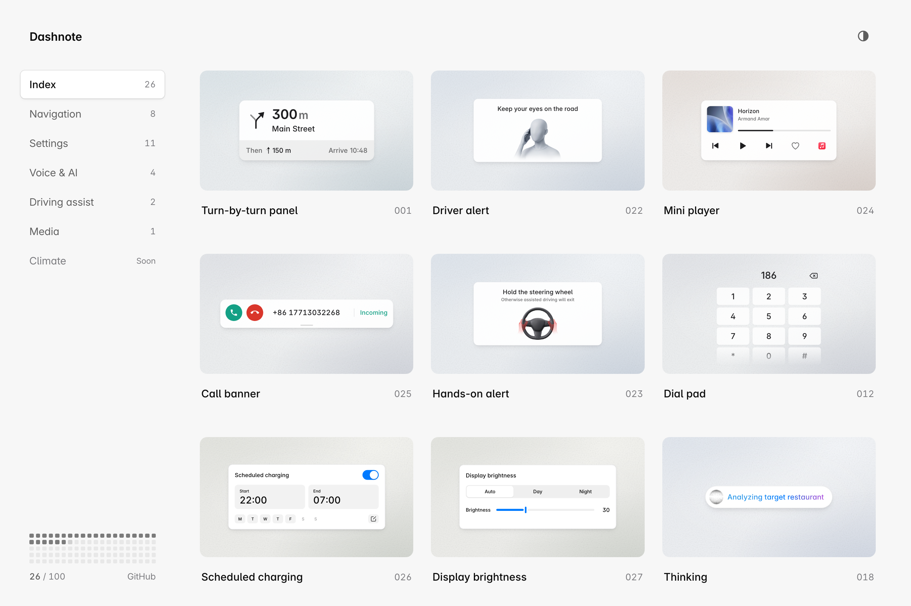
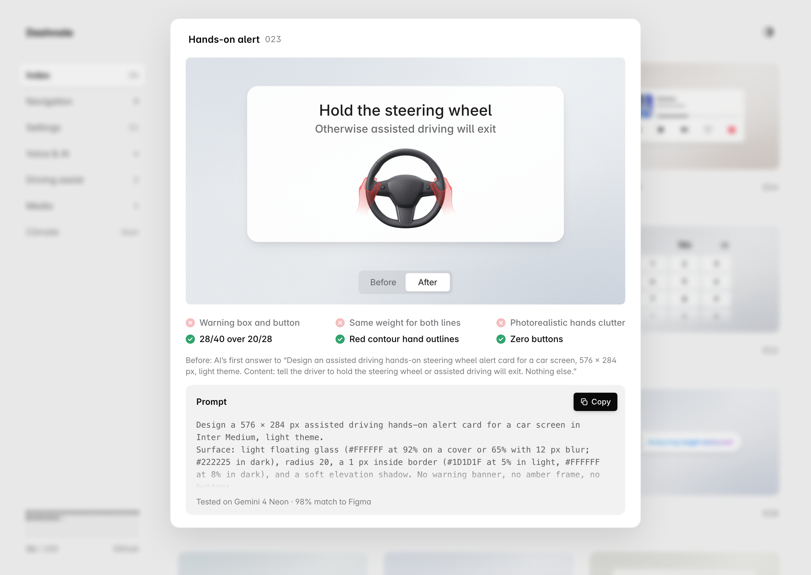
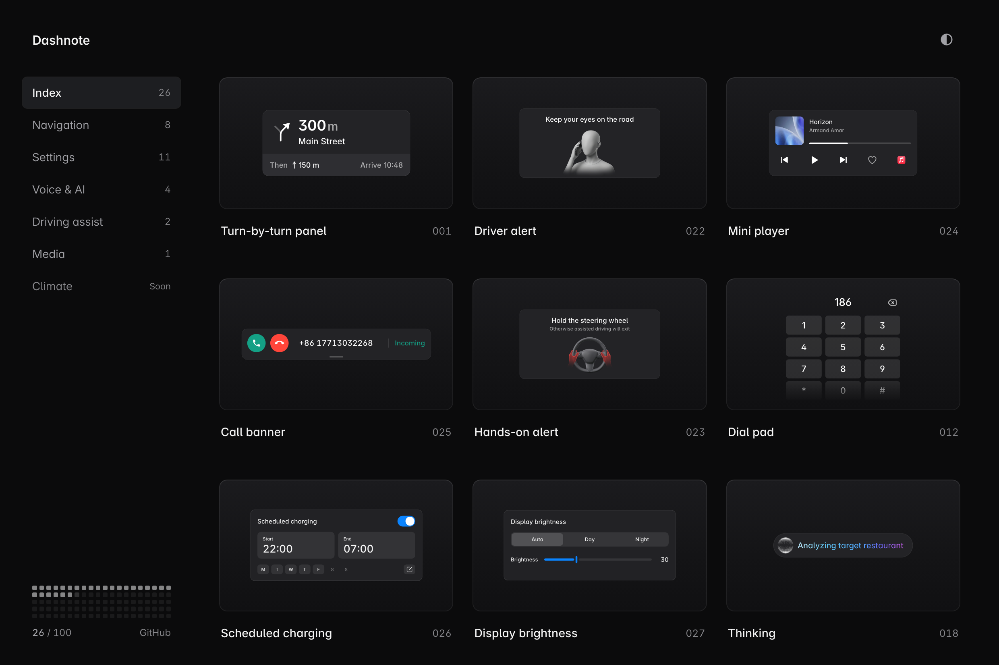

# Dashnote

**A notebook on designing car screens with AI.** Real automotive HMI components with interactive Before / After comparisons, concise design rules, and copy-ready prompts tested against cockpit guidelines. Built by [Paxton Yao](https://github.com/Paxton0209) using [Halden](https://paxton0209.github.io/halden/) and [Dashline](https://paxton0209.github.io/Dashline/).

[Open Dashnote](https://paxton0209.github.io/dashnote/) · [Design principles](docs/00-design-principles.md) · [Cockpit MCP](prototypes/cockpit-mcp/README.md) · [中文说明](#中文说明) · [License](LICENSE)



## Why this project exists

Ask an AI coding or design tool to generate an in-car screen and it defaults to mobile-app habits: full sentences instead of a glanceable distance and turn arrow, 16 px labels, unnecessary row dividers, dismiss buttons on urgent driving alerts, and decorative glass blur.

In a moving vehicle, every component is read at arm's length under a 2-second glance budget while the driver's attention stays on the road. Dashnote documents what AI gets wrong on real cockpit UI, shows the corrected component side by side, and records the explicit visual and ergonomic constraints needed to make AI output match automotive standards.

## What's inside

| Navigation | Settings | Voice & AI | Driving assist | Media | Climate | Published |
| :---: | :---: | :---: | :---: | :---: | :---: | :---: |
| 8 | 11 | 4 | 2 | 1 | Soon | **26 / 100** |

Every published entry is an interactive component running directly in the browser. Browse by chapter, switch between Light (`Halden`) and Dark OLED (`Halden Dark`) modes, open any entry to compare **Before** and **After** in place, and copy the prompt used to generate it.

## Before, After, and the prompt that fixes it

Each entry opens into a focused inspection sheet containing the live interactive component, a **Before / After** toggle against AI's unguided first draft, the specific violations and fixes (typography hierarchy, touch target size, icon restraint, surface contrast), and a copy-ready prompt tested against the Figma library.



## Light and dark cockpit surfaces

Dashnote pairs neutral surfaces (`#FFFFFF` and `#F5F5F7` in light mode; `#141416` to `#262628` graphite in dark mode) with a single functional accent (`#007AFF` / `#0A84FF`) reserved strictly for active, selected, or progress states. Switching to dark mode automatically engages `Halden Dark` to prevent optical blooming on OLED displays without layout shift.



## Cockpit MCP

This repository includes [`prototypes/cockpit-mcp`](prototypes/cockpit-mcp/README.md), a zero-dependency local MCP server (`Node 18+`, stdio) that exposes 79 automotive HMI rules, Day / Night DTCG color tokens, component specs, screen region templates, and a layout violation checker to AI coding agents.

```bash
claude mcp add cockpit -- node /path/to/dashnote/prototypes/cockpit-mcp/server.mjs
```

See [prototypes/cockpit-mcp/README.md](prototypes/cockpit-mcp/README.md) for the full tool list and Cursor / agent configuration.

## Repository contents

| Path | Description |
| --- | --- |
| `site/` | Interactive Dashnote web app deployed to GitHub Pages |
| `docs/00-design-principles.md` | Shared aesthetic DNA, Car HMI vs Web boundaries, structural patterns, and anti-patterns |
| `docs/images/` | Rendered notebook screenshots used in this README |
| `docs/` | Product definition, decisions log, reference deconstruction, card guidelines, and motion specs |
| `prototypes/cockpit-mcp/` | Zero-dependency MCP server with automotive HMI rules, tokens, and layout checker |
| `before/` | Reference "Before" AI first-draft prototypes |
| `tests/` | Prompt evaluation and component checks |

## Local preview

```bash
python3 -m http.server 8000 --directory site
```

Then open `http://localhost:8000` in your browser.

## License

Licensed under the [MIT License](LICENSE).

---

## 中文说明

**Dashnote 是一本用 AI 设计汽车座舱界面的公开笔记。** 目前已发布 **26 / 100** 个真实车载 HMI 组件，覆盖导航（8）、设置（11）、语音与 AI（4）、驾驶辅助（2）与媒体（1），空调章节持续补充中。

直接让 AI 画车机界面时，它通常会照搬手机 App 的习惯，比如用长句子写导航提示、把字号缩到 16 px、在紧急接管弹窗里硬塞确认按钮。Dashnote 把这些高频翻车点逐条拆开，每张卡片都带可交互的 **Before / After** 实时对比、明确改动依据与验证过的可复制提示词，同时支持浅色（Halden）与深色 OLED（Halden Dark）主题切换。

仓库里还附带了一个零依赖的本地 [`cockpit-mcp`](prototypes/cockpit-mcp/README.md) 服务，内置 79 条座舱交互与视觉规则、日夜 Token 与布局检查工具，可直接接入 Claude Code、Cursor 等 Agent。全库代码采用 [MIT](LICENSE) 开源许可。
